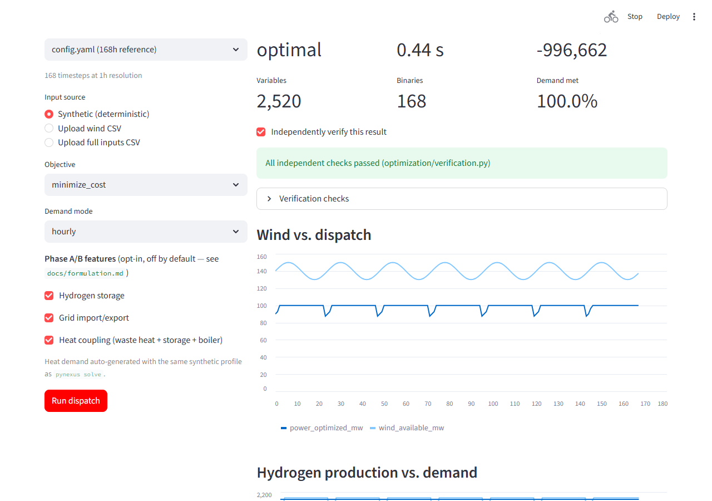
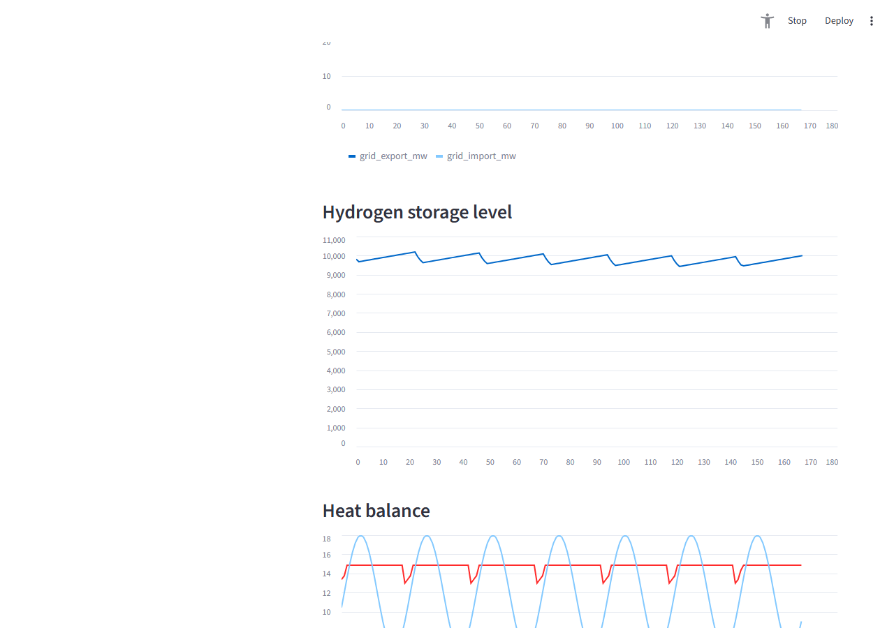
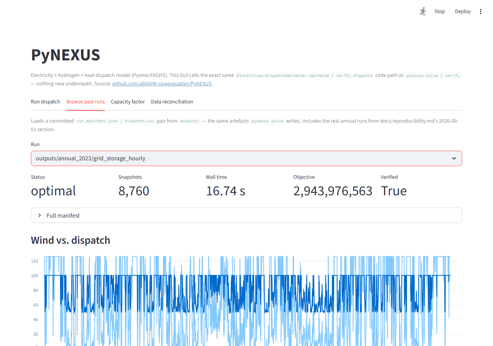
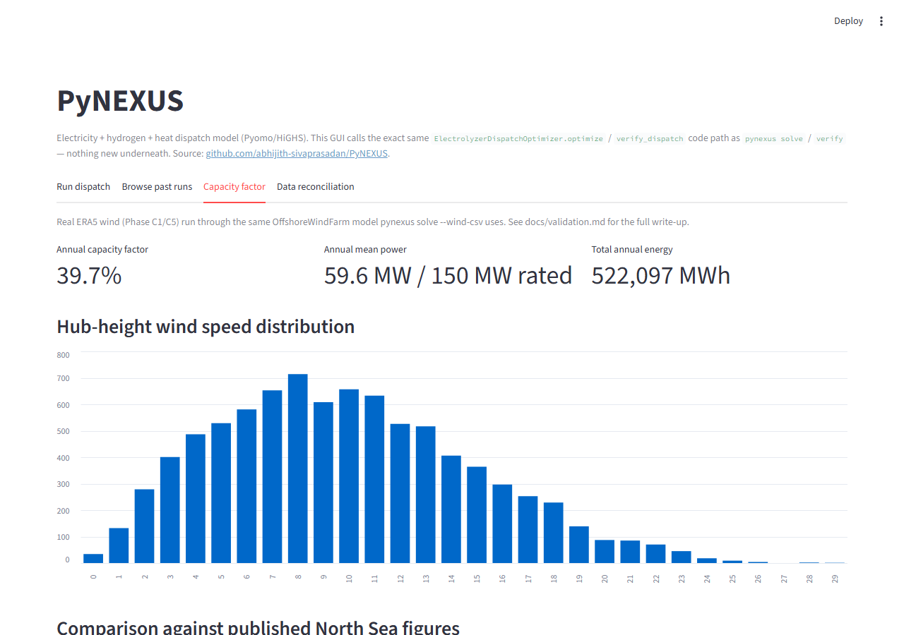
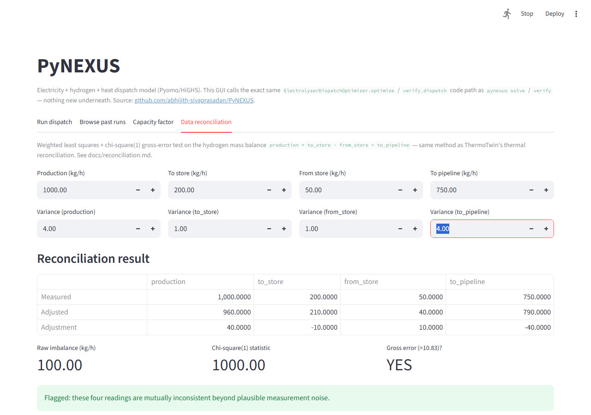

# PyNEXUS

A reproducible Pyomo/HiGHS model coupling electricity, hydrogen, and heat: hourly dispatch of an offshore-wind, PEM-electrolyser, hydrogen-storage/pipeline, grid-connected, and heat-recovery system, under physical operating constraints and alternative cost and emissions objectives.

## Scope

The checked-in reference configuration covers 168 hourly timesteps; `configs/annual.yaml` covers the full 8,760-hour year and has a real recorded run (see below). The model includes wind availability, electrolyser minimum/maximum load and ramping, a simplified hydrogen-pipeline capacity constraint, and hydrogen-demand constraints. Hydrogen storage, grid import/export, and electrolyser waste-heat recovery (with heat storage and backup boiler) are all implemented but opt-in (`optimize(enable_storage=True, enable_grid=True, enable_heat=True)`) and off by default. It is a screening model, not a project-specific engineering design.

`data/era5.py` implements and unit-tests a real Copernicus Climate Data Store fetch, nearest-grid-cell extraction, hub-height shear correction, and a committed provenance record (`pynexus fetch-era5` / `fetch-era5-year`) — see [`docs/data_provenance.md`](docs/data_provenance.md). A full year of real 2023 ERA5 wind for the configured North Sea site has been fetched (chunked by month, per a real CDS request-size limit) and run through the dispatch model — see [`docs/reproducibility.md`](docs/reproducibility.md)'s 2026-09-01 section and [`docs/validation.md`](docs/validation.md) for the resulting capacity factor. `data/entsoe.py` implements and unit-tests the equivalent path for ENTSO-E day-ahead prices, but has no live fetch yet (needs a separate `ENTSOE_API_KEY`) and isn't wired into `pynexus solve` — `--wind-csv` pairs real wind with synthetic prices as an interim hybrid. Deterministic tests continue to use synthetic arrays.

## Quick start

```bash
python -m venv .venv
# Windows: .venv\Scripts\activate
source .venv/bin/activate
pip install -e ".[dev]"
pytest -q
pynexus solve --config configs/tiny_test.yaml --synthetic --output outputs/tiny
pynexus verify --run outputs/tiny
```

For the 168-hour reference, replace the config with `config.yaml` and use a fresh
output directory. `--synthetic` is explicit: no ENTSO-E/ERA5 data are downloaded.
Alternatively supply `--input inputs.csv`; see [input schema](docs/input_schema.md).
The legacy `python -m optimization.dispatch` demonstration remains interactive.

The runner saves the exact config, inputs, dispatch, hashes, environment, solver
settings/status, model size and independent numerical checks. It rejects an
existing output directory to prevent stale results after a failed solve.

`--enable-storage`, `--enable-grid`, `--enable-heat` (add `--demand-mode hourly`
alongside — storage/heat are no-ops in cumulative mode, see `docs/formulation.md`)
turn on Phase A/B: hydrogen storage, grid import/export, and electrolyser
waste-heat/heat-storage/boiler coupling. `--enable-heat` requires a
`heat_demand_mw` input column — auto-generated for `--synthetic`/`--wind-csv`,
required in a user `--input` CSV. All three are recorded in the run manifest and
independently re-checked by `verify`, same as the baseline path.

`pynexus fetch-era5 --config config.yaml --start-date YYYY-MM-DD --end-date YYYY-MM-DD`
fetches real ERA5 wind from the Copernicus Climate Data Store and writes a
provenance record; it requires the `[data]` extra and a CDS account (see
[`docs/data_provenance.md`](docs/data_provenance.md)) and is independent of `solve`/`verify`.

## GUI

`ui/app.py` is a Streamlit GUI over the exact same `ElectrolyzerDispatchOptimizer.optimize` / `verify_dispatch` code path `pynexus solve` / `verify` use — no separate logic, nothing the CLI can't already do.

```bash
pip install -e ".[ui]"
streamlit run ui/app.py
```

**Run dispatch** — configure a run (config, input source, objective, demand mode, Phase A/B toggles) and solve it live, with the same independent verification and a downloadable `dispatch.csv`:



Enabling storage/grid/heat adds their own charts (this is the same run, scrolled down):



**Browse past runs** — load any committed `run_manifest.json`/`dispatch.csv` pair from `outputs/`, including the real annual runs from `docs/reproducibility.md`'s 2026-09-01 section:



**Capacity factor** — the real ERA5-derived capacity factor (`docs/validation.md`) computed live from `data/raw/era5_2023_wind.csv`:



**Data reconciliation** — an interactive version of `docs/reconciliation.md`'s WLS + chi-square(1) gross-error test; biasing one sensor here trips the same flag the tests check for:



## Configuration

`config.yaml` remains the backward-compatible weekly default. `configs/tiny_test.yaml` is a compact deterministic test configuration. `configs/annual.yaml` is the 8,760-hour configuration, added after a complete run with recorded solver status and checked output — see `docs/reproducibility.md`. Its wind-only and grid-only-cumulative variants are genuinely infeasible against real 2023 wind at the configured demand rate; the recorded successful run uses `--enable-grid --enable-storage --demand-mode hourly` and still leaves ~16% of annual demand unmet — a real capacity-planning finding, not a claim that the configured system fully meets its own demand target.

## Method and evidence

- `docs/formulation.md` — decision variables, objective, constraints, and units
- `docs/assumptions.md` — implemented scope and limitations
- `docs/data_provenance.md` — source/configuration boundary
- `docs/reconciliation.md` — hydrogen mass-balance WLS reconciliation and gross-error detection
- `docs/validation.md` — capacity-factor sanity check against a published source
- `docs/results.md` — does heat coupling change dispatch? A tested finding, with figure
- `docs/verification.md` — deterministic test evidence and validation terminology
- `ui/app.py` — Streamlit GUI (see [GUI](#gui) above)
- `tests/` — fast component and optimisation tests
- [Reproducibility and change evidence](docs/reproducibility.md)

## Research work packages (WP1–WP7)

The energy-technology research protocol is in [docs/research/RESEARCH_PROTOCOL.md](docs/research/RESEARCH_PROTOCOL.md). The repository implements adequacy-first dispatch and verification (WP1), 17 intervention combinations (WP2), independently checked constraint diagnostics (WP3), the five-year 2021–2025 weather experiment (WP4), a gated illustrative cost-accounting framework (WP5), and IAMC-compatible exchange of verified WP4 metrics (WP6). **No market-derived LCOH, official IAMC variable registry or observed plant data are claimed.**

**WP7 research paper:** [source-audited manuscript](docs/research/WP7_MANUSCRIPT_TEMPLATE.md), [reproducibility and evidence protocol](docs/research/WP7_REPRODUCIBILITY.md), and [GitHub Actions workflow](.github/workflows/wp7.yml) that rebuilds four figures, three tables and the rendered paper from the archived WP2–WP6 evidence. It is an author working paper, not a peer-reviewed empirical or economic validation.

For the reproducible WP6 CSV export, see [WP6 protocol and commands](docs/research/WP6_IAMC_PROTOCOL.md) and [the local variable dictionary](research/wp6_variables.json). The registered WP4 synthesis must match the pinned historical artifact hash; the exporter runs a full `pyam` write/read round trip before accepting the output.

## Contributing

See `CONTRIBUTING.md`. Calculation changes require tests and explicit units. Never change physics, constraints, data, or solver tolerances merely to obtain a preferred result.

## Licence

Code in this repository is available under the MIT License. Third-party dependencies retain their own licences.

## Parallel execution and CI

Optional mpi4py distribution of independent synthetic demand/price scenarios with standalone equivalence checks and measured end-to-end timings. See [docs/mpi_scaling.md](docs/mpi_scaling.md).

CI runs on Ubuntu, Windows and macOS. ThermoTwin-F uses release/debug profiles and serial/OpenMP builds; PyNEXUS tests Python 3.10, 3.11 and 3.12 and runs a separate Linux MPI equivalence job. Weekly runs check dependency drift. Hosted run status is available in the repository’s Actions tab; documented local measurements are separate from hosted verification.
